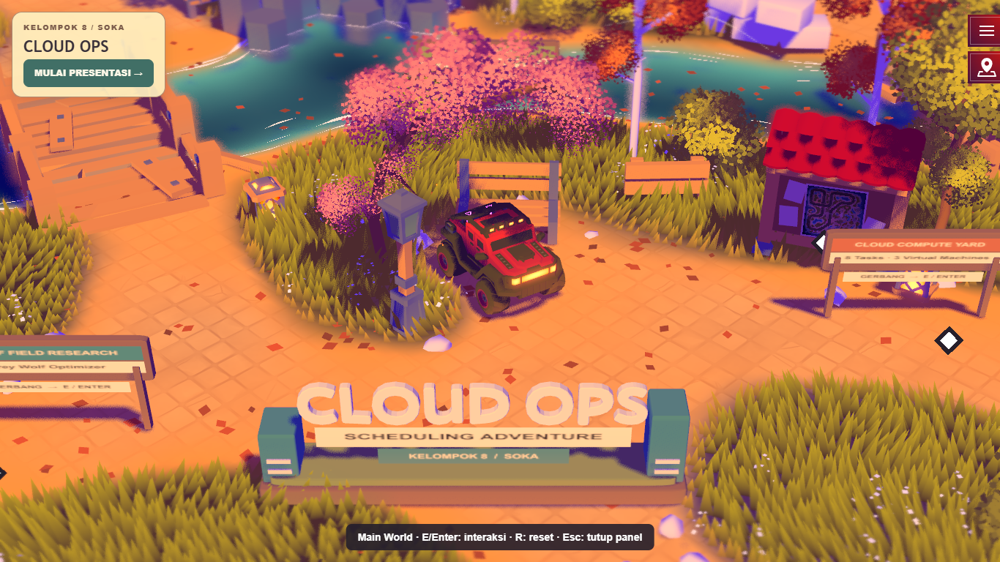
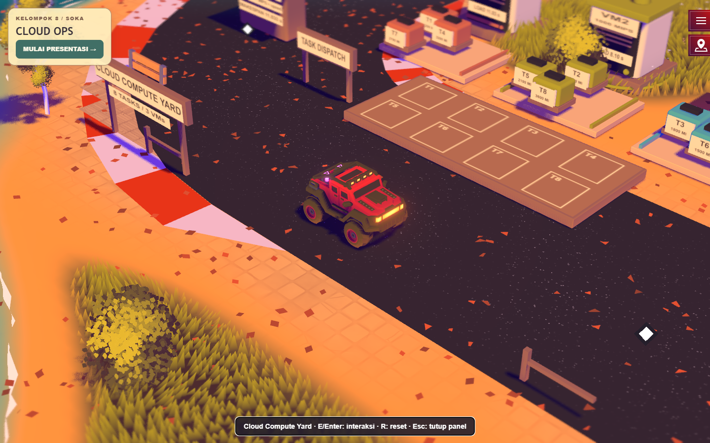
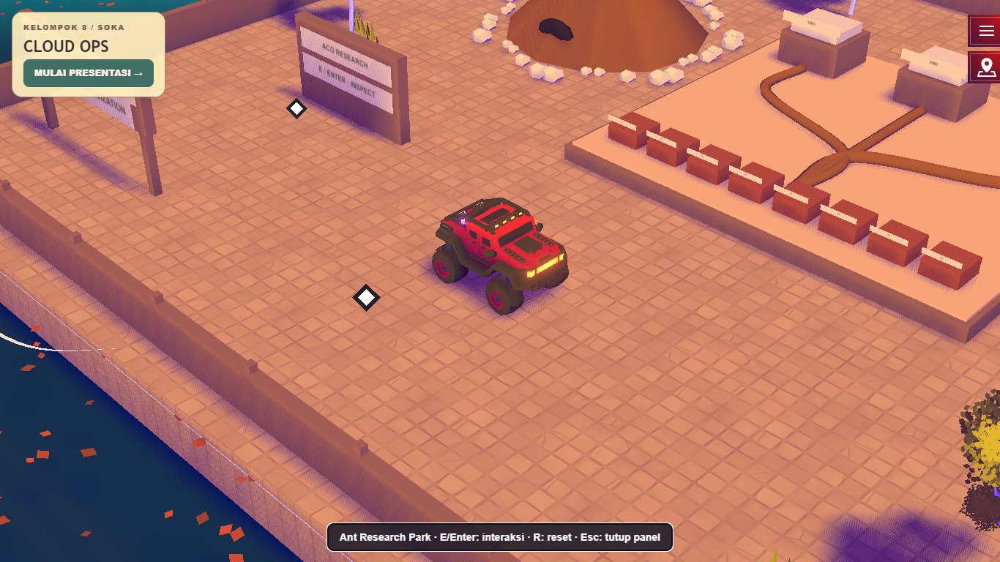
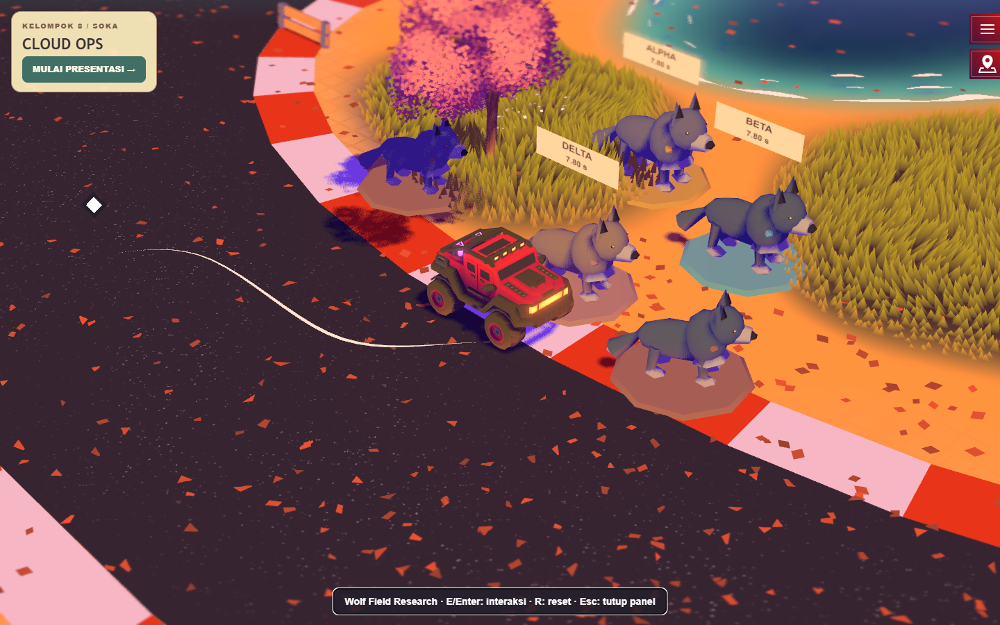
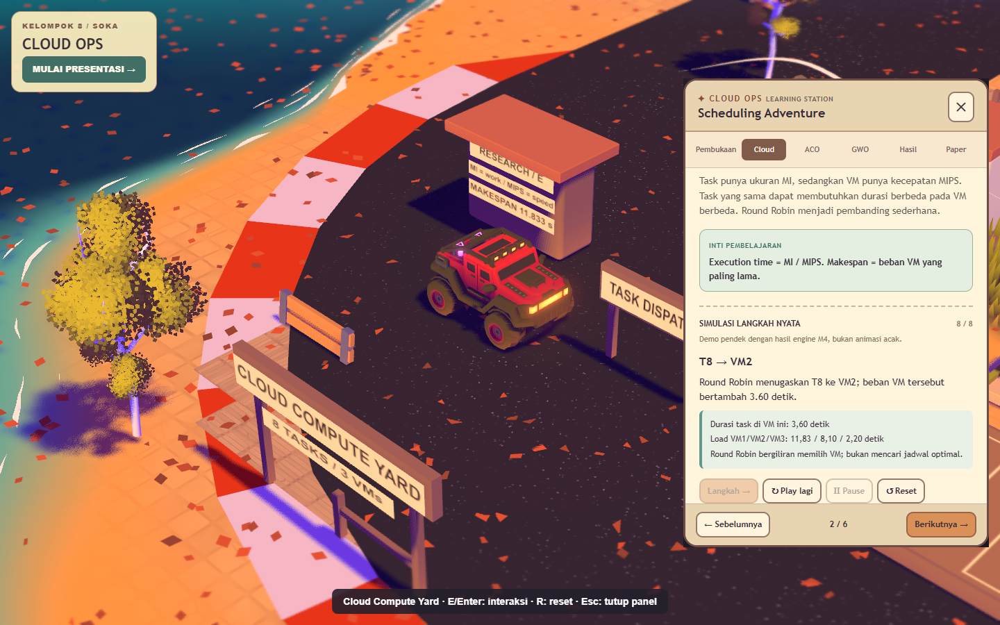
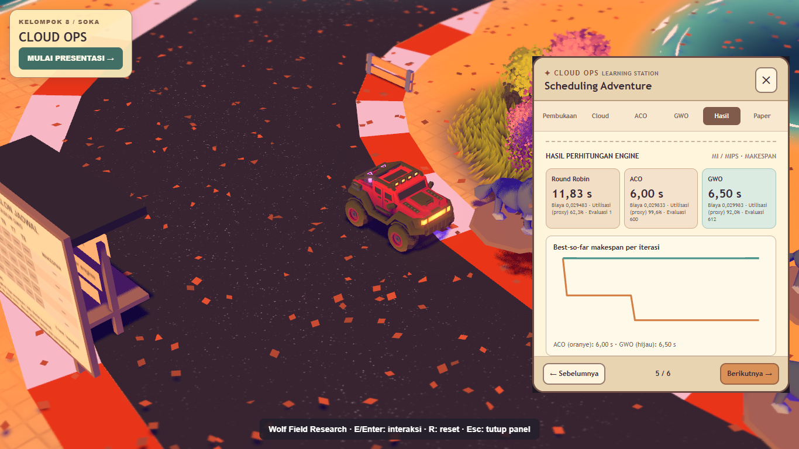

# Cloud Ops: Scheduling Adventure

**Kelompok 8 — Strategi Optimasi Komputasi Awan (SOKA)**

Jelajahi kampus dengan mobil 3D, kirim task ke virtual machine, dan amati bagaimana **Round Robin, Ant Colony Optimization, serta Grey Wolf Optimizer** menyusun jadwal. Alokasi, nilai, dan grafik berasal dari engine JavaScript nyata yang dapat diuji.



[Mainkan di GitHub Pages](https://arkanzahir.github.io/Soka-cloud-ops-scheduling-adventure/) · [Jalankan secara lokal](#instalasi-dan-menjalankan-lokal) · [Dokumentasi teknis](#dokumentasi-lanjutan)

<details>
<summary>Pratinjau world, presentasi, dan hasil</summary>

| Cloud Compute Yard | Ant Research Park |
| --- | --- |
|  |  |

| Wolf Field Research | Presentation Mode |
| --- | --- |
|  |  |



Screenshot browser asli dari game terintegrasi, bukan mockup. Bukti lengkap tersedia pada laporan QA.

</details>

## Tentang proyek

Cloud Task Scheduling menentukan **task mana dijalankan pada VM mana**. Task memiliki beban kerja berbeda; VM memiliki kecepatan berbeda. Pembagian jumlah task yang merata belum tentu memberi waktu selesai tercepat.

Game memperagakan pencarian jadwal dengan **makespan minimum**: waktu sampai seluruh task selesai. ACO membangun solusi melalui pilihan probabilistik dan feromon; GWO memperbarui populasi solusi dengan panduan tiga pemimpin. Keduanya dibandingkan dengan Round Robin pada data yang sama.

## World dan gameplay

| World | Isi dan interaksi |
| --- | --- |
| **Cloud Ops Campus** | Hub utama dengan kendaraan 3D, gerbang ke tiga zona, arena Classic Race, dan akses ke kredit proyek. |
| **Cloud Compute Yard** | Antrean paket task dan rak VM. Animasi Round Robin memperlihatkan paket berpindah, beban tiap VM bertambah, dan makespan berubah. |
| **Ant Research Park** | Sarang, 12 semut, jalur feromon, dan pintu VM. Mode Koloni memperlihatkan pilihan seluruh semut. Mode Fokus menampilkan keputusan dan probabilitas satu semut. |
| **Wolf Field Research** | Lima kandidat terbaik dari 12 serigala. Label Alpha, Beta, dan Delta, papan alokasi task, serta rekor makespan mengikuti hasil engine. |

**Free Drive** memberi akses ke zona melalui gerbang kampus. **Classic Race** menempatkan enam pos opsional di sisi lintasan: Pembukaan → Cloud → ACO → GWO → Hasil → Paper. Satu lap memakai sembilan crossing asli dan timer balap. Dashboard bisa disembunyikan sambil balapan dan simulasi terus berjalan.

**Dashboard** menyediakan Langkah, Play, Pause, dan Reset. Tab Hasil menyajikan tabel alokasi task, makespan, biaya simulasi, utilisasi proksi, dan grafik konvergensi. Pengaturan grafis Low/High tersedia melalui menu.

| Kontrol | Fungsi |
| --- | --- |
| **WASD / tombol panah** | Mengemudi dan membelokkan mobil. |
| **B / Shift** | Rem / boost. |
| **E / Enter** | Berinteraksi dengan gerbang atau stasiun terdekat. |
| **Esc** | Menyembunyikan dashboard atau menutup menu. |
| **R** | Reset kendaraan di Free Drive. |
| **L** | Membuka dashboard di zona aktif atau saat berada di marka pos balap. |
| **M** | Mematikan atau menyalakan semua audio. |

## Algoritma dan representasi solusi

| Metode | Alur inti | Visualisasi |
| --- | --- | --- |
| **Round Robin** | Membagi task bergiliran ke VM1 → VM2 → VM3. | Paket berpindah ke VM dan beban terakumulasi. |
| **ACO baseline** | Tiap semut menyusun jadwal dengan feromon dan heuristik beban; evaluasi diikuti evaporasi/deposit. | Pilihan VM seluruh koloni, probabilitas semut fokus, dan pembaruan feromon. |
| **GWO baseline** | Alpha/Beta/Delta memandu pembaruan vektor kandidat; koordinat didiskretisasi menjadi indeks VM lalu dievaluasi. | Lima jadwal, ID/peran/fitness, VM tujuan setiap task, dan perubahan assignment per ID. |

Satu kandidat adalah delapan pilihan VM, misalnya `[0,1,2,0,1,2,0,1]` pada engine; tampilan memakai VM1–VM3. **Satu serigala mewakili satu jadwal lengkap, bukan satu task.** Pencarian terjadi pada solusi pembagian task, bukan jarak berjalan menuju VM. [Cara membaca papan GWO](docs/GWO_SCHEDULE_EXPLAINER.md).

Implementasi adalah **baseline edukatif**, bukan reproduksi identik OACC atau GWO_C/M dari paper. Objektif utamanya makespan; biaya dan utilization proxy adalah metrik sekunder. Satu seed/dataset tidak membuktikan algoritma selalu unggul.

## Dataset dan model matematis

Skenario standar memakai **8 task independen, non-preemptive** dan **3 VM heterogen**. Setiap task mendapat tepat satu VM, dengan eksekusi berurutan pada VM tersebut. Model tidak memasukkan transfer jaringan, kedatangan dinamis, kegagalan, atau overhead virtualisasi. Panel eksperimen Cloud dan ACO mendukung 4, 6, atau 8 task serta 2 atau 3 VM. Pengaturan 10, 25, atau 50 iterasi berlaku untuk hasil eksperimen ACO. Demo GWO dan tab Hasil memakai skenario standar.

| Task | T1 | T2 | T3 | T4 | T5 | T6 | T7 | T8 |
| --- | ---: | ---: | ---: | ---: | ---: | ---: | ---: | ---: |
| Beban (MI) | 1200 | 2400 | 1800 | 3200 | 2100 | 1500 | 2700 | 3600 |

| VM | Kecepatan (MIPS) | Biaya simulasi / detik |
| --- | ---: | ---: |
| VM1 | 600 | 0,0010 |
| VM2 | 1000 | 0,0015 |
| VM3 | 1500 | 0,0025 |

MI = *million instructions*; MIPS = *million instructions per second*.

```text
durasi(i,j)       = MI[i] / MIPS[j]
load[j]          = jumlah durasi task pada VM j
makespan         = max(load[j])
cost             = jumlah load[j] × costPerSecond[j]
utilizationProxy = jumlah load[j] / (jumlah VM × makespan)
```

Contoh terverifikasi: T1 pada VM1 membutuhkan **1200/600 = 2 detik**. Round Robin menghasilkan beban **[11,833333; 8,1; 2,2] detik**, makespan **11,833333 detik**, biaya **0,029483333 unit simulasi**, dan mean utilization proxy **62,35%**. Biaya bukan tarif cloud nyata; proxy bukan pengukuran CPU utilization.

Tab Hasil memakai dataset yang sama, seed **42**, **50 iterasi** untuk ACO dan GWO, serta populasi **12**. Makespan standar adalah **11,83 detik** untuk Round Robin, **6,00 detik** untuk ACO, dan **6,50 detik** untuk GWO. Demo ACO dan GWO memakai empat iterasi sehingga nilainya dapat berbeda. Anggaran evaluasi antaralgoritma berbeda. [Spesifikasi model dan pengujian](docs/ALGORITHM_SPEC.md).

## Instalasi dan menjalankan lokal

Gunakan **Node.js 22.17.0** seperti lingkungan uji. Vite mensyaratkan Node 20.19+ atau 22.12+. Browser yang diuji adalah Google Chrome desktop dengan WebGPU. WebGPU membutuhkan HTTPS atau localhost. Fallback WebGL tersedia dari fondasi renderer, tetapi belum termasuk penerimaan perangkat proyek.

```bash
git clone https://github.com/Arkanzahir/Soka-cloud-ops-scheduling-adventure.git
cd Soka-cloud-ops-scheduling-adventure
npm ci
npm run dev
```

Buka URL localhost yang ditampilkan Vite. Game berjalan langsung dengan pengaturan bawaan. `.env` dan backend bersifat opsional. Biarkan `VITE_SERVER_URL` dan `VITE_GAME_PUBLIC` kosong untuk build publik.

`.npmrc` menggunakan `legacy-peer-deps=true` untuk plugin upstream lama yang peer range-nya belum mencakup Vite 7. Versi dependency tidak di-upgrade pada finalisasi ini. Di PowerShell, gunakan `npm.cmd` bila diperlukan.

Verifikasi dan preview produksi:

```bash
npm test
npm run build
npm run test:build
npm run preview
```

Output berada di `dist/`. Vite `base: './'` menjaga aset relatif. Pemeriksaan subpath repository:

```bash
npm run preview -- --host 127.0.0.1 --port 4173 --base /Soka-cloud-ops-scheduling-adventure/
```

Buka `http://127.0.0.1:4173/Soka-cloud-ops-scheduling-adventure/`. Tes browser otomatis memerlukan Chrome dan Playwright; perintah serta hasilnya ada di [laporan QA final](docs/FINAL_RELEASE.md).

## Teknologi

**JavaScript, HTML/CSS, Three.js/TSL, WebGPURenderer, Rapier 3D, Vite, GLB/Blender**, CanvasTexture dan SVG. Evaluator/algoritma terpisah dari renderer; M5 meneruskan trace ke world dan M6 menyajikan pembelajaran serta perbandingan.

## Referensi ilmiah

1. **Wang, H. (2024).** Research on Task Scheduling Model of Ant Colony Optimization Cloud Computing Platform for Online Practical Customer-training Application. *IEIE Transactions on Smart Processing & Computing*, **13**(3), 243–253. [DOI: 10.5573/IEIESPC.2024.13.3.243](https://doi.org/10.5573/IEIESPC.2024.13.3.243).
2. **Wang, H., Zhang, J., Fan, J., Zhang, C., Deng, B., & Zhao, W. (2025).** An improved grey wolf optimizer with flexible crossover and mutation for cluster task scheduling. *Information Sciences*, **704**, 121943. [DOI: 10.1016/j.ins.2025.121943](https://doi.org/10.1016/j.ins.2025.121943).
3. **Mirjalili, S., Mirjalili, S. M., & Lewis, A. (2014).** Grey Wolf Optimizer. *Advances in Engineering Software*, **69**, 46–61. [DOI: 10.1016/j.advengsoft.2013.12.007](https://doi.org/10.1016/j.advengsoft.2013.12.007).

Paper pertama membahas improved ACO/OACC; paper kedua membahas GWO_C/M dengan crossover/mutation; paper ketiga menjelaskan GWO standar. Game **tidak mengklaim mereplikasi hasil eksperimen paper**. Paper ACO DBpia semula belum terverifikasi; referensi ACO di atas adalah alternatif terverifikasi. [Kajian dan batas akademik](docs/PAPER_REVIEW.md).

## Kontributor, kredit, dan lisensi

**Kelompok 8** mengadaptasi world Cloud/ACO/GWO, engine scheduling, bridge simulasi, panel pembelajaran/presentasi, perbandingan, branding kampus, dokumentasi, dan integrasi. Nama/pembagian individu tidak dicantumkan karena belum tersedia catatan terverifikasi.

Fondasi teknis dan visual berasal dari **[Folio 2025 karya Bruno Simon](https://github.com/brunosimon/folio-2025)**: kendaraan, kamera, physics, terrain, renderer, aset dan interaksi. Copyright **© 2025 Bruno Simon** dan [lisensi MIT](license.md) dipertahankan. Proyek ini tidak menyatakan endorsement Bruno Simon.

Musik latar oleh **Kounine** dan musik balap **Sky Blue Street** oleh **MintoDog** memakai CC0. Kredit model semut, serigala, audio lolongan, dan font tersedia di menu **Tentang Proyek** dan [Third-party notices](THIRD_PARTY_NOTICES.md).

## Dokumentasi lanjutan

[QA terbaru](docs/WORK_HANDOFF.md#presentation-race-audio-mix--2026-11-06) · [Model algoritma](docs/ALGORITHM_SPEC.md) · [Arsitektur fondasi](docs/ARCHITECTURE_AUDIT.md) · [Kontribusi](CONTRIBUTING.md) · [Inventaris aset](docs/ASSET_CATALOG.md) · [Deployment](docs/DEPLOYMENT_READINESS.md)
